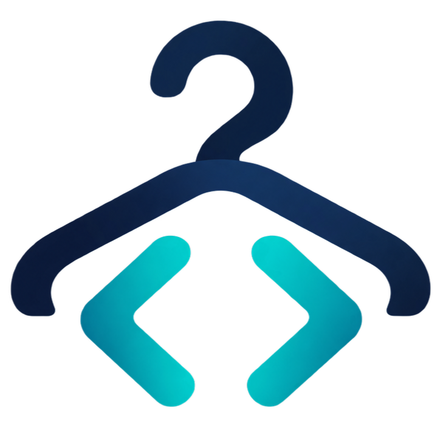

# Vardrop

<p align="center">
  
</p>

Self-hosted registry for the text you retype all day: connection strings, API keys,
prompt snippets, agent skills, images, and file bundles.

One server, two faces:

- **Web panel** (installable PWA) — for *looking and writing*: browse clusters,
  edit entries, manage users, read the audit log.
- **Desktop client** (Windows / macOS / Linux) — for *using*: press
  `Ctrl+Alt+V` anywhere, search, **Enter** copies the value,
  **Shift+Enter** pastes it straight into the window you were typing in.

No accounts on our side, no telemetry, single SQLite file on your disk.
License: [MIT](LICENSE).

```
┌────────────────────────────────┐            ┌──────────────────────────────────┐
│  SERVER — Registry              │            │  CLIENT — Vardrop                │
│                                │            │                                  │
│  axum REST API  ◄───────────────┼──HTTPS────►│  tray + global hotkey Ctrl+Alt+V │
│  Admin panel (PWA)              │   JSON     │  popup near the caret            │
│  SQLite (sqlx)                  │            │  search → copy / paste-after-    │
│  Secrets: AES-256-GCM           │            │  focus, image → clipboard        │
│  Versions · Audit · Tokens      │            │  PAT auth (read scope)           │
└────────────────────────────────┘            └──────────────────────────────────┘
```

## Features

- **Cluster → Group tree → Entry** organization, unlimited depth.
- Content kinds: `text` / `json` / `yaml` / `binary` / `bundle` (multi-file packages).
- **Secrets** encrypted at rest (AES-256-GCM, single `master.key`), masked previews,
  optional **PIN gate** — a 10-minute unlock window per device; every reveal is audited.
- **Versions**: every write creates a new version; restore any of them.
- **Images**: upload via drag-drop, file picker, or `Ctrl+V` from the clipboard;
  server-generated thumbnails appear in the panel and the client popup.
  The client can put an image on the clipboard as a real bitmap.
- **Paste-after-focus**: `Shift+Enter` hides the popup, returns focus to the window
  that was active when you pressed the hotkey, and sends `Ctrl+V`.
- **Tokens**: login sessions and personal access tokens, SHA-256 hashed server-side,
  scopes `read` / `write` / `admin`, 1–3650-day validity, revocable, last-use tracked.
- **Audit log**: logins (success and failure), entry changes, secret reveals, file reads.
- **PWA**: install the panel to your desktop or phone; offline shell, API never cached.
- Login brute-force guard: 5 failures → 60 s IP lockout.

## Quick start (server)

Recommended: Docker.

```bash
docker compose up -d --build
docker compose exec registry cat /data/initial-admin-password.txt
docker compose exec registry rm /data/initial-admin-password.txt
```

Panel: `http://127.0.0.1:8080`. Log in as `admin` with the printed password, change it,
then set a PIN if you will store secrets.

Expose it beyond loopback only behind TLS — see
[docs/SELF-HOST.md](docs/SELF-HOST.md) (Caddy/Nginx examples, systemd unit,
published `ghcr.io` image, release archive without Docker):

```bash
docker compose --profile tls up -d      # Caddy + automatic certificates
```

Back up three things together: `master.key` (lost key = unreadable secrets),
`registry.db`, `storage/`.

## Install the client

Grab your platform package from [Releases](../../releases):

| Platform | File |
|---|---|
| Windows x64 | `Vardrop_*_x64-setup.exe` (per-user install: `%LOCALAPPDATA%\Vardrop`) |
| macOS arm64 / x64 | `*.dmg` |
| Linux x64 / arm64 | `.deb` / `.rpm` / `.AppImage` |

Then connect it:

1. In the panel open **Tokenlar**, create a **read** PAT (validity 1–3650 days;
   the raw token is shown exactly once).
2. Launch Vardrop, enter your **server URL** and the **PAT**.
3. `Ctrl+Alt+V` opens the popup. Type to search, ↑↓ to move.

| Key | Action |
|---|---|
| `Enter` | Copy value (images: bitmap to clipboard) |
| `Shift+Enter` | Copy **and** paste into the previously focused window |
| `Backspace` | Back to the group tree |
| `Esc` | Hide popup |

Paste-after-focus support: **Windows** full (explicit window restore + `SendInput`).
**macOS** via `osascript` — grant Accessibility permission on first use.
**Linux** via `xdotool` on X11; on Wayland the copy stays on the clipboard with a
notice — paste it manually.

## API

Bearer token, JSON everywhere:

```
POST /api/auth/login              { username, password } → { token, user }
POST /api/auth/unlock             { pin }                 → 10-min secret window
GET  /api/auth/me · /api/auth/tokens (PAT create/list/delete)

GET/POST   /api/clusters · /api/clusters/{id}/groups · PATCH/DELETE /api/groups/{id}
GET/POST   /api/entries?q=&cluster_id=&group_id=&kind=&tag=&secret=
GET/PATCH  /api/entries/{id} · /api/entries/{id}/versions/{v}/restore
POST /api/entries/{id}/files          (multipart upload)
GET  /api/entries/{id}/value          (text/json value · binary download · ?file_id= for bundles)
GET  /api/entries/{id}/thumbnail      (160px JPEG for image entries)
GET/DELETE /api/entries/{id}/files/{fid}

GET/POST/PATCH/DELETE /api/users       (admin)
GET  /api/audit?user=&action=&from=&to= (admin)
GET  /api/health
```

Full design and schema: [docs/PLAN.md](docs/PLAN.md) (Turkish).

## Roles

| Role | Read | Write | Users / audit |
|---|---|---|---|
| admin | ✓ | ✓ | ✓ |
| editor | ✓ | ✓ | — |
| viewer | ✓ | — | — |

Secret values additionally require the PIN window for every identity — admin included.

## Repository layout

```
crates/vardrop-core/      shared DTOs, content kinds, role/scope model
crates/vardrop-server/    axum server: api/, auth/, crypto, storage, thumbnails
apps/admin-web/           panel — Vite + React + TS + Tailwind, PWA (public/)
apps/client/             Vardrop — Tauri 2, vanilla JS popup
deploy/                   Caddy, systemd, Docker configs
docs/                     PLAN.md · SELF-HOST.md · RELEASES.md
```

## Development

```bash
cargo run -p vardrop-server -- init     # creates config.toml, data/, prints admin password
cargo run -p vardrop-server -- serve
cargo test --workspace
```

Panel (dev server proxies `/api` → 127.0.0.1:8080):

```bash
cd apps/admin-web
npm ci
npm run dev        # http://localhost:5173
npm run build      # dist/ — served by the server (panel.dist config)
```

Client:

```bash
cd apps/client
npm ci
npm run tauri dev
npm run tauri build   # apps/client/src-tauri/target/release/bundle/
```

Config: `config.example.toml` for development (CORS open for the Vite port),
`config.host.example.toml` for deployments. Path resolution: `--config`,
else `VARDROP_CONFIG`, else `./config.toml`.

## Security notes

- Secrets are AES-256-GCM encrypted with `master.key`; DB backups keep them sealed.
  No key rotation yet — see [DEVNOTES.md](DEVNOTES.md).
- Passwords: argon2id. Tokens: stored as SHA-256 hashes, raw value shown once.
- Client PAT lives in a plain file under the user profile
  (`%LOCALAPPDATA%\vardrop`), not an OS keychain — rationale and threat model in
  [SECURITY.md](SECURITY.md).
- Traffic is plain HTTP on the wire — put TLS in front for anything beyond loopback.
- Builds are unsigned: SmartScreen / Gatekeeper will warn.

Known gaps and deliberate deviations are tracked in [DEVNOTES.md](DEVNOTES.md).
Release process: [docs/RELEASES.md](docs/RELEASES.md).

## License

[MIT](LICENSE)
